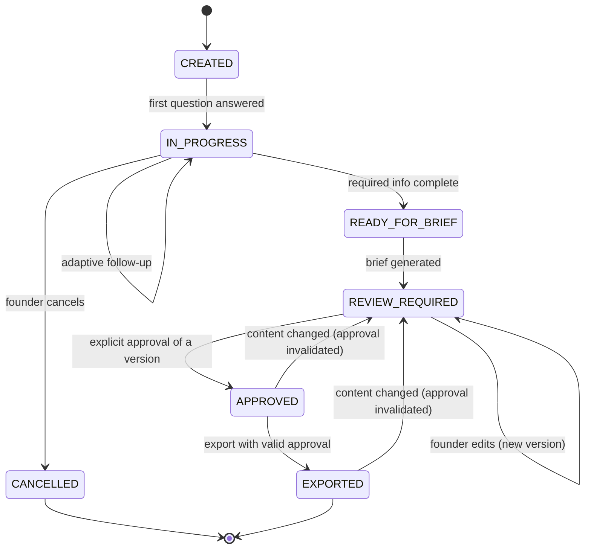

# FounderShield AI — API Contracts

> **Status:** Phase 00 planning document. Contracts are the agreed target;
> implementation lands in later phases. No endpoints exist yet.

## 1. Conventions

- Base path: `/api`. Health is unprefixed: `/health`.
- Auth: Supabase-issued JWT in `Authorization: Bearer <token>`. The backend
  verifies the JWT and derives `owner_id`; the client never asserts ownership.
- All timestamps are ISO-8601 UTC. All IDs are UUID v4 strings.
- Errors use a consistent envelope (see §5).
- Mutating endpoints that cause external effects (export) require an
  `Idempotency-Key` header.

## 2. Core domain models (conceptual Pydantic shapes)

These are the agreed field sets; exact code lands in Phase 02 / Phase 06.

```text
Owner            { id, email, created_at }
InterviewSession { id, owner_id, status, locale, provider,
                   question_count, paused, created_at, updated_at }
InterviewRecord  { id, session_id, question_key, question_text,
                   answer_text (redacted), source (founder|ai_suggestion),
                   is_dont_know, created_at }
ProblemBrief     { id, session_id, owner_id, current_version_id,
                   status, created_at, updated_at }
BriefVersion     { id, brief_id, version_number, content (BriefContent),
                   content_hash, created_by (founder|ai), created_at }
BriefContent     { title, problem_statement, affected_users, current_process,
                   evidence[], constraints[], desired_outcome, success_metrics[],
                   confirmed_facts[], founder_provided_claims[], assumptions[],
                   unknowns[], recommended_next_steps[], source_references[],
                   version, status }
ApprovalRecord   { id, brief_version_id, owner_id, approved_content_hash,
                   destination?, status (active|invalidated),
                   approved_at, invalidated_at? }
AuditEvent       { id, owner_id, session_id?, event_type, metadata (no PII),
                   created_at }
```

`status` for a session is one of the interview states in §4.

## 3. Endpoints

| Method | Path | Purpose | Authz |
|--------|------|---------|-------|
| GET | `/health` | Liveness/readiness | public |
| POST | `/api/sessions` | Create interview session | owner |
| GET | `/api/sessions/{id}` | Fetch session (owner-scoped) | owner |
| GET | `/api/sessions/{id}/next-question` | Next adaptive question | owner |
| POST | `/api/sessions/{id}/answers` | Submit an answer (redacted server-side) | owner |
| POST | `/api/sessions/{id}/pause` | Pause | owner |
| POST | `/api/sessions/{id}/resume` | Resume | owner |
| POST | `/api/sessions/{id}/cancel` | Cancel | owner |
| POST | `/api/sessions/{id}/brief` | Generate brief (→ REVIEW_REQUIRED) | owner |
| GET | `/api/briefs/{id}` | Fetch brief + current version | owner |
| PUT | `/api/briefs/{id}` | Edit → creates new immutable version | owner |
| GET | `/api/briefs/{id}/versions` | List versions | owner |
| POST | `/api/briefs/{id}/versions/{vid}/approve` | Approve exact version | owner |
| POST | `/api/briefs/{id}/export` | Export approved version (idempotent) | owner |
| POST | `/api/sessions/{id}/voice/init` | Start voice session (adapter) | owner |
| POST | `/api/sessions/{id}/voice/stop` | Stop/cleanup voice session | owner |

## 4. Interview state diagram (Mermaid)



Transitions are enforced in backend code. Any transition not drawn here is
rejected (see SECURITY_MODEL invalid-transition handling).

## 5. Error envelope

```json
{
  "error": {
    "code": "string_enum",
    "message": "human-readable, no sensitive data",
    "request_id": "uuid"
  }
}
```

- Error messages must never contain secrets, raw sensitive input, or stack
  traces. `request_id` correlates to redacted server logs.
- Representative codes: `unauthorized`, `forbidden`, `not_found`,
  `invalid_state_transition`, `validation_error`, `approval_required`,
  `approval_invalidated`, `redaction_blocked`, `rate_limited`,
  `provider_unavailable`.

## 6. Consistency notes

- The brief field set in `BriefContent` matches the Phase 06 Pydantic schema
  one-to-one.
- Session `status` values match the Phase 04 state machine exactly.
- `approve` and `export` semantics match the Phase 07 approval rules in
  `SECURITY_MODEL.md`.
