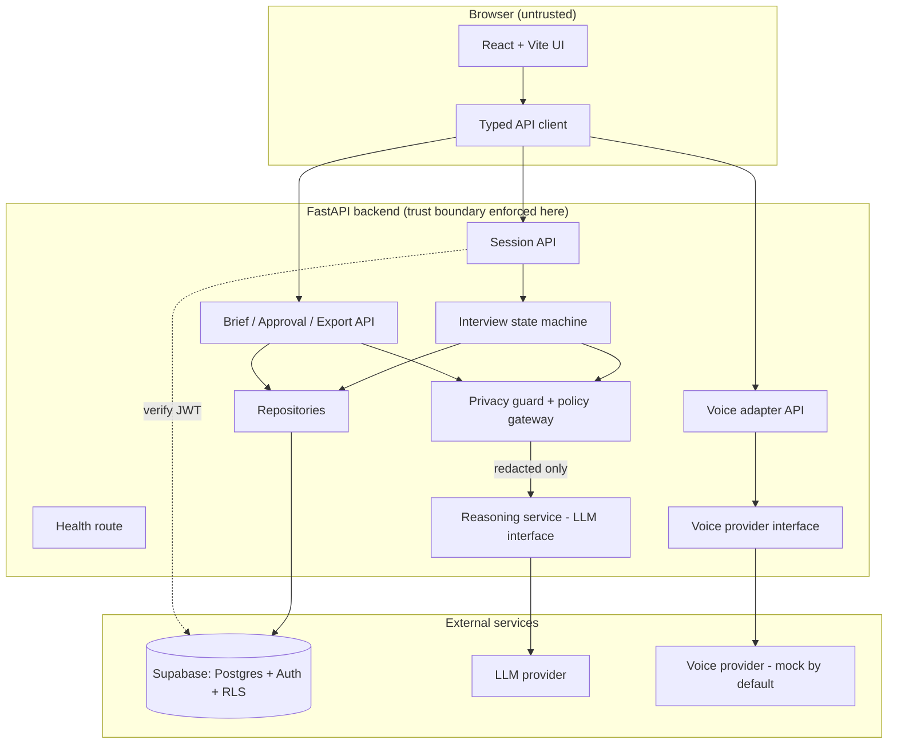

# FounderShield AI — Architecture

> **Status:** Phase 00 planning document. No code implemented yet.

## 1. Approved stack

| Layer | Technology |
|-------|-----------|
| Frontend | React + Vite + TypeScript |
| Backend | Python + FastAPI |
| Validation | Pydantic (v2) |
| Database + Auth | Supabase (Postgres + Auth, RLS enabled) |
| Voice | Provider adapter (Bolna \| Smallest AI \| Sarvam) — mock by default |
| Reasoning | One configurable LLM provider behind an interface |
| Backend tests | pytest |
| Frontend tests | Vitest + React Testing Library |
| Deployment | Decided after later phases (not in Phase 00) |

## 2. Proposed folder structure

Chosen to fit a clean greenfield repo. Backend and frontend are siblings so
each has independent tooling and CI.

```
voiceAgent/
├── docs/                     # this phase's deliverables
├── backend/
│   ├── app/
│   │   ├── main.py           # FastAPI entry point
│   │   ├── config.py         # validated settings (pydantic-settings)
│   │   ├── logging.py        # structured logging + redaction filter
│   │   ├── api/              # routers (health, sessions, briefs, voice)
│   │   ├── schemas/          # Pydantic request/response + domain models
│   │   ├── services/         # interview engine, privacy guard, reasoning
│   │   │   ├── privacy/      # detection + redaction + policy gateway
│   │   │   ├── interview/    # state machine
│   │   │   ├── reasoning/    # LLM provider interface + mock
│   │   │   └── voice/        # voice provider interface + mock
│   │   ├── repositories/     # data access (Supabase + local test doubles)
│   │   └── db/               # SQL migrations + RLS policies
│   ├── tests/
│   ├── pyproject.toml
│   └── .env.example -> ../.env.example (documented in root)
├── frontend/
│   ├── src/
│   │   ├── main.tsx
│   │   ├── App.tsx
│   │   ├── api/              # typed API client
│   │   ├── components/       # shell, loading/error/empty states
│   │   └── screens/          # landing, interview, review
│   ├── index.html
│   ├── package.json
│   └── vite.config.ts
└── .env.example              # placeholders only (root reference)
```

## 3. Component architecture (Mermaid)



**Key rule:** the Privacy guard sits between the backend and the LLM. No path
reaches the LLM without passing through redaction + policy decision.

## 4. Session & brief lifecycle

See `API_CONTRACTS.md` for the interview-state diagram and endpoint list.
Briefs are versioned; approvals bind to an immutable version
(see `SECURITY_MODEL.md`).

## 5. Trust boundaries

1. **Browser → Backend:** the browser is untrusted. All authz, session
   isolation, redaction, and approval are enforced server-side.
2. **Backend → Supabase:** RLS enforces per-owner row access as defense in depth
   even if an application check is missed.
3. **Backend → LLM:** only redacted, minimized payloads cross this boundary.
4. **Backend → Voice provider:** adapter-mediated; mock by default; real
   provider only after a data-flow review.

## 6. Unresolved architecture decisions (to close in later phases)

- AD-1: Session-token model for the voice stream (browser-direct vs.
  backend-proxied) — depends on verified provider capabilities (Phase 05).
- AD-2: LLM provider selection and config schema (Phase 06).
- AD-3: Deployment target and CORS origins for production (Phase 09).
- AD-4: Whether transcripts are redacted-then-retained or discarded per turn
  (Phase 02 retention policy + Phase 03 privacy contract).
